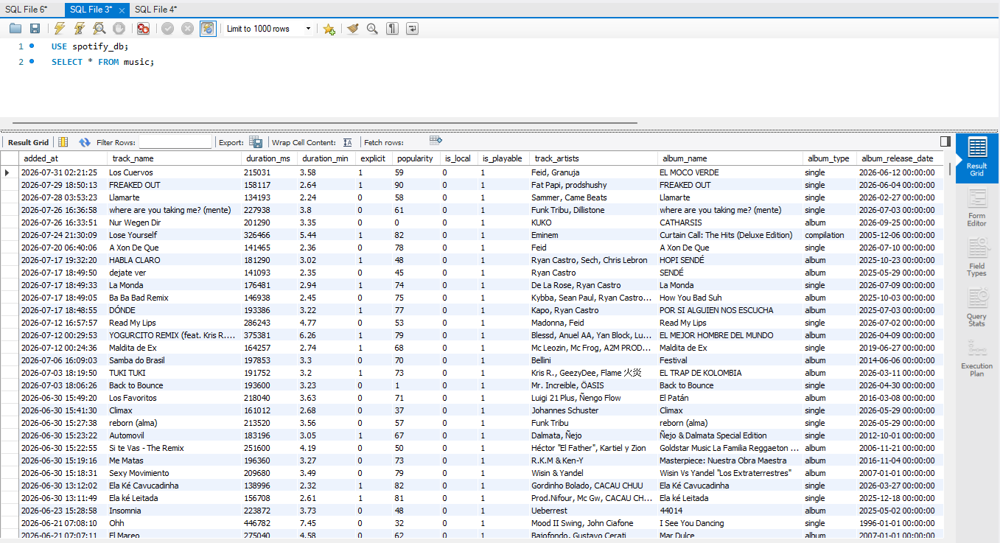

# Spotify Data Pipeline


## Overview
This project pulls every track saved in a user's Spotify library and lands it in a MySQL database, ready to query. It started out as a modular "ETL software" — separate `extract/`, `transform/`, and `load/` packages, most of them placeholders. That structure got in the way more than it helped: the load step never grew past a JSON stub, and the extra folders added indirection without adding value.

The project is now a **pipeline**, not an ETL framework: one script, three functions, run in order. No speculative abstractions, no placeholder modules waiting to be filled in — just `extract() → transform() → load()`, and the data ends up in a real database at the end of it.

## How it works
1. **Authenticate** — Spotify OAuth 2.0 (via Spotipy) opens a browser for consent the first time; the token is cached to `token_cache.json` and reused (and re-validated) on later runs.
2. **Extract** — pages through `GET /me/tracks` (50 at a time) until there's nothing left, and dumps the raw API responses to `data.json`. If `data.json` already exists, extraction is skipped — the step is idempotent by design.
3. **Transform** — flattens the raw JSON into a pandas DataFrame: track name, duration (ms and minutes), explicit flag, popularity, playability, artists joined into one string, album name/type/release date/artwork, with dates parsed to proper datetimes.
4. **Load** — opens a SQLAlchemy engine (via PyMySQL) from the DB credentials in `.env` and writes the DataFrame straight into the `music` table.

## Architecture
Everything lives in a single file, `ETL.py`, as three plain functions called sequentially from `__main__`:

- `extract()` — handles auth, pagination, rate-limit-friendly delays, and the raw dump to disk.
- `transform()` — pure data-shaping, JSON in, DataFrame out.
- `load()` — DataFrame in, MySQL table out.

This replaces the old `ETL/extract`, `ETL/transform`, `ETL/load` package layout. That structure was built for a modularity the project never needed — a linear pipeline reads and maintains more easily as one file than as a package tree with placeholder `__init__.py`s.

## Data in the database
Once loaded, the data lives in the `music` table inside the `spotify_db` MySQL database:

```sql
USE spotify_db;
SELECT * FROM music;
```



Each row is one saved track, with columns for `added_at`, `track_name`, `duration_ms` / `duration_min`, `explicit`, `popularity`, `is_local`, `is_playable`, `track_artists`, `album_name`, `album_type`, and `album_release_date` — a flattened, query-ready view of everything Spotify's API returns for a saved track.

## Tech Stack
- Python 3.x
- Spotipy (Spotify API / OAuth client)
- Pandas (data shaping)
- SQLAlchemy + PyMySQL (MySQL load)
- python-dotenv (environment variables)
- Requests (raw API pagination)

## Key Features
- OAuth 2.0 authentication with token caching and re-auth on revoked/invalid tokens
- Paginated extraction with rate-limit-friendly delays
- Idempotent extract step — skips re-fetching if `data.json` already exists
- Structured logging throughout (`etl_process.log`)
- Direct load into a MySQL table, no intermediate manual step

## Status
✅ Functional end-to-end — extract, transform, and load into MySQL all implemented and working.

## Project Structure
```
├── .env                   # Environment variables (Spotify + DB credentials)
├── .gitignore              # Git ignore file
├── data.json               # Raw extracted tracks (cache)
├── etl_process.log         # Log file
├── ETL.py                  # The pipeline: extract, transform, load
├── README.md                # This file
├── requirements.txt        # Python dependencies
├── token_cache.json         # Cached OAuth tokens
├── images/
│   └── SQL.png              # Screenshot of the loaded data in MySQL
└── spotyenv/                # Virtual environment
```
